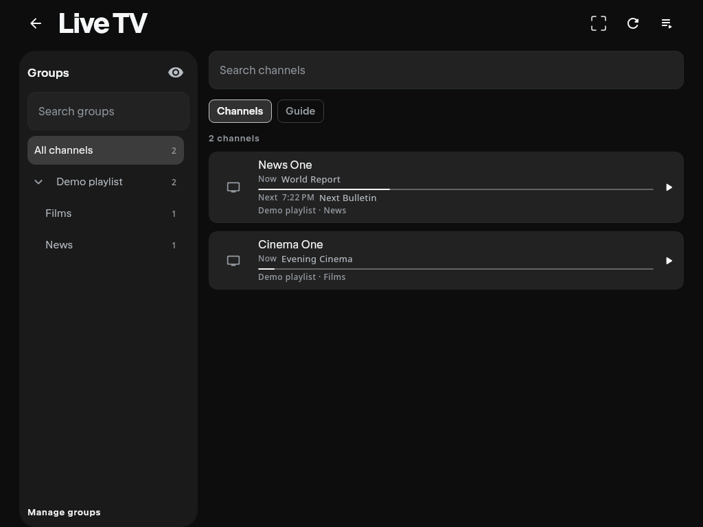
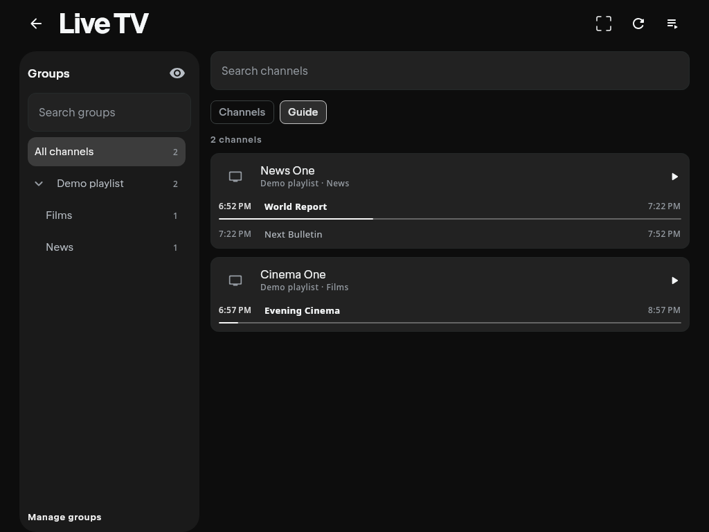
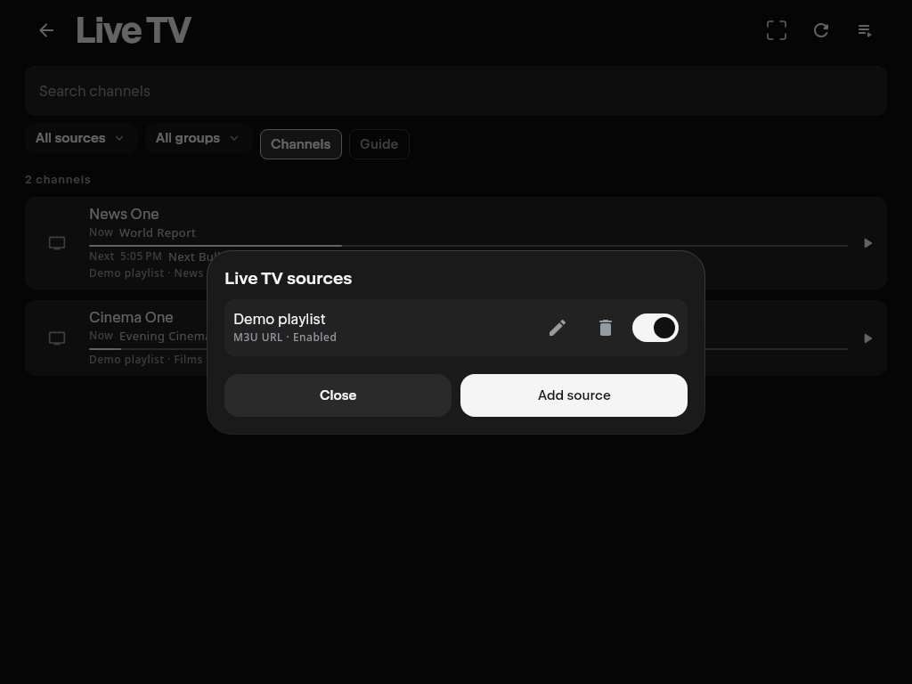
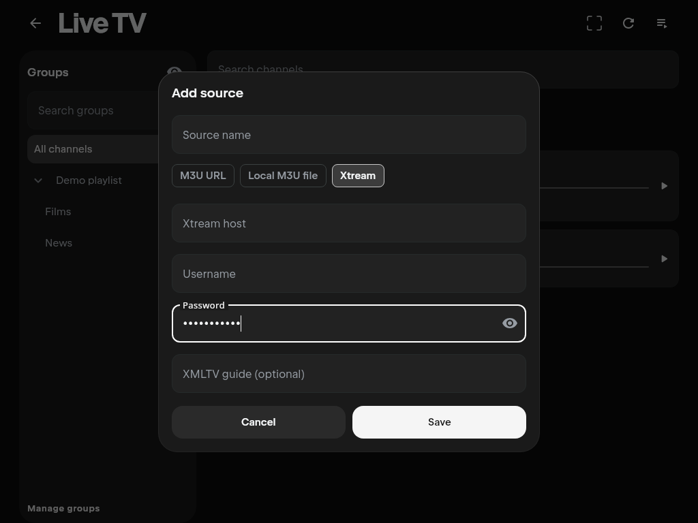
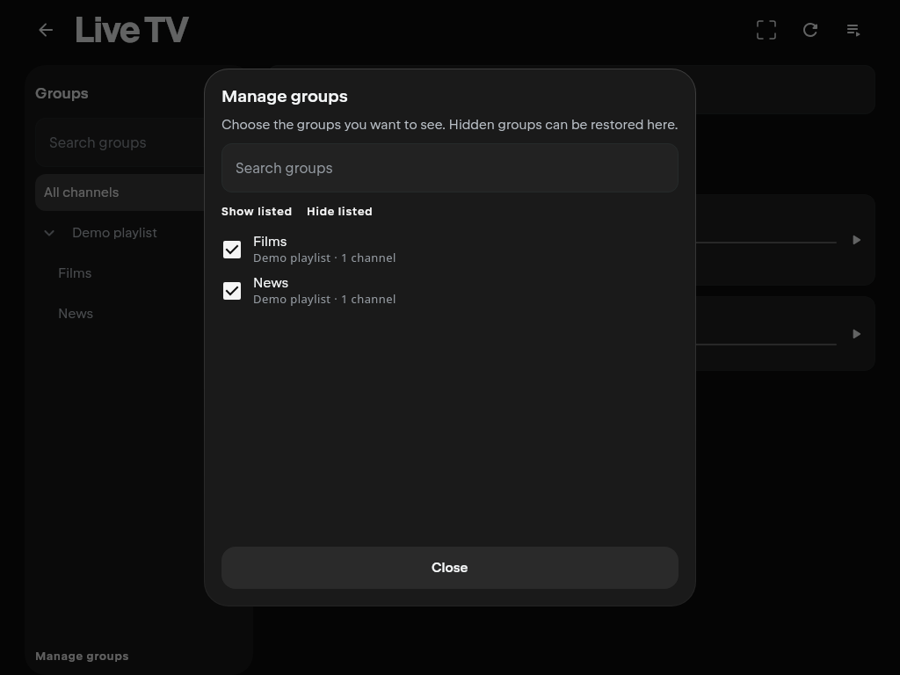
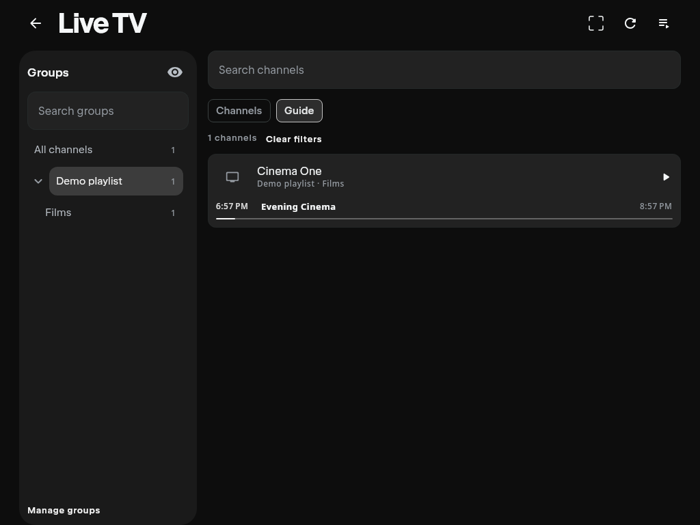

# Native IPTV contribution notes

## Feature request draft

**Title:** [Feature]: Desktop Live TV with M3U, Xtream and XMLTV

**Area:** Streams / Sources

**Problem:** Desktop users cannot directly import an IPTV playlist or Xtream
account, browse its channels and groups, or see current/upcoming programmes.
Third-party addons can expose streams but do not provide a native source manager
or a programme guide. Live sessions also need explicit playback semantics so
they do not become VOD resume/watched/scrobble records.

**Proposal:** Add a desktop Live TV tab with searchable channels,
a source/group sidebar, logos, now/next information and a programme guide.
Hide unused groups per profile and restore them in a searchable group manager. Allow multiple M3U URLs, local M3U files and Xtream Codes sources, with optional XMLTV programme
data and individual enable/disable, edit, delete and refresh controls. Reuse
the native player with live controls and channel switching.

Keep source credentials local and encrypted; do not sync IPTV configuration or
bundle subscriptions/playlists. Keep ingestion and UI in desktop source sets,
with only the screen bridge and live player policy in shared code. Reuse current
dependencies and preserve the default VOD behavior.

**Alternatives:** A Stremio addon can supply streams with less app integration,
but cannot provide this native source and programme-guide workflow. A separate
IPTV application already provides that workflow but requires leaving Nuvio.

**Implementation available for discussion:** I have prepared a local desktop
prototype and would like maintainer approval of the feature scope before
submitting an implementation PR. It uses the existing Compose/theme components
and dependencies. Source credentials remain local and encrypted, and IPTV source
configuration is excluded from account sync.

**Verification so far:**

- Linux desktop compilation passes.
- The latest focused runs passed 139 IPTV/live-playback-policy cases and four
  navigation cases, covering parsing, source lifecycle, encrypted storage,
  live/VOD behavior, group management, tab navigation and UI interaction.
- A read-only check against a saved source verified channel import and automatic
  XMLTV discovery/import, including a guide larger than the previous 64 MiB
  buffer limit. Guide ingestion now streams the document with bounded retention.
- Synthetic Compose screenshots demonstrate the browser, guide, source editor
  and group manager and can be supplied without provider credentials or content.

**Remaining work before merge:**

- Integrate the branch with current `Dev`, commit the latest fixes and rerun the
  full regression suite. The recorded full-suite comparison predates the latest
  changes; it reported the four unchanged baseline failures and an intermittent
  failure in the unchanged QuickJS runtime.
- Verify actual native video playback, rapid channel switching, Retry and
  Back/teardown on the supported desktop platforms. Automated controller/UI tests
  and channel/EPG imports do not establish end-to-end media playback coverage.
- Complete Windows/macOS runtime, file-dialog, storage-permission and packaging
  checks. The current validation was performed on Linux.

**Requested decision:** Would native desktop IPTV support fit Nuvio's direction,
and would you approve a contribution in this scope? I can reduce the initial
scope or split it into ingestion/storage, live-player behavior and desktop UI
PRs according to maintainer preference. This request seeks scope approval; it
does not claim the prototype is ready to merge.

## PR description draft (only after approval)

**Approved issue:** _Add the issue URL and explicit maintainer approval._

Desktop gains a Live TV destination for importing M3U playlists and Xtream live
channels, managing multiple sources, browsing a source/group list, hiding unused
groups per profile and viewing XMLTV programme data. Channel launches reuse the native player with an explicit live
policy that excludes resume, watched-state, scrobbling and episode automation.

Source configuration stays local and is encrypted at rest. No source list,
credential, subscription service or new dependency is bundled. Non-desktop
navigation remains unchanged.

**Scope:** Desktop ingestion/storage/UI; shared screen boundary and player live
policy required by desktop. No unrelated maintenance or styling changes.

**Verification:** Desktop and shared metadata compile. All 130 added tests pass.
The completed full suite has 1,771 cases, five failures and one skip: the four
unchanged baseline failures plus an intermittent timeout in the unchanged QuickJS
concurrent-scraper test. Both QuickJS tests pass on a separate targeted repeat.
No existing upstream tests were removed. See the validation details and actual Compose screenshots below.

**Review slices:**

1. Desktop parsers, source repository, encrypted persistence and tests.
2. Explicit shared live playback policy and regression tests.
3. Desktop navigation, source/channel/guide UI and playback wrapper.

## Current Dev integration (2026-10-29)

Integrated upstream `Dev` at `cafd3fe909c213e3a46f1b0fb4384154872834f8`.
The merge preserves chapters, stream information and automatic subtitle sync for
VOD. Live playback skips chapter discovery/seeking and automatic subtitle sync;
paired live/VOD regression tests cover both policies.

Linux desktop compilation and shared Kotlin metadata compilation pass. The full
desktop suite completed **1,832 tests: 1,826 passed, five failed, one skipped**.
All **149 IPTV/live-policy and desktop navigation cases passed**. The five failing
cases match the previously recorded three animated-image assertions, legacy
watch-progress assertion and intermittent QuickJS concurrent-scraper timeout.
The suite used isolated app storage. See
[current Dev test results](validation/iptv-current-dev-tests.json).

A local unsigned Linux DEB also builds and passes the existing runtime-dependency
and package-metadata verification scripts. The DEB lookup now accepts both JDK
filename conventions for the default Debian release (`version-1` and `version`).
Platform installer builds use empty `local.properties`; production service
credentials, signing identities and Sentry uploads are not required or bundled.

## Upstream verification baseline

Base: `NuvioMedia/NuvioDesktop`, branch `Dev`, commit
`897efe93` (fetched 2026-10-24).

Environment: Linux x86_64, JDK 21, repository Gradle wrapper. An empty ignored
`local.properties` is needed because upstream's `generateRuntimeConfigs` declares
that file as an input even when no private service configuration is used.

The untouched baseline was checked in a detached checkout, separately from the
IPTV branch:

```sh
./gradlew :composeApp:compileKotlinDesktop :composeApp:desktopTest --no-daemon
```

Desktop compilation passed. Tests: **1,641 run, 4 failed, 1 skipped**.
Existing failures:

- `CollectionCardRemoteImageTest.animatedImageDoesNotRequireAFileExtension`
- `CollectionCardRemoteImageTest.animatedGifStillPlaysOnHover`
- `CollectionCardRemoteImageTest.animatedWebpPlaysOnHoverAndRestoresCoverOnExit`
- `WatchProgressIdentityTest.legacy payload derives episode progress key and preserves completed position`

The native `frame_copy_test` also passed. iOS compilation and simulator tests
cannot run on Linux. This baseline does not establish Windows/macOS playback or
provider compatibility; those require platform/provider testing.

## Implementation validation (2026-10-24)

```sh
./gradlew :composeApp:compileKotlinDesktop :composeApp:desktopTest --no-daemon
./gradlew :composeApp:compileCommonMainKotlinMetadata --no-daemon
node --check composeApp/src/desktopMain/resources/player-ui/controls.js
```

Desktop compilation and common metadata compilation passed. The full desktop
command exits nonzero: **1,771 cases, 1,765 passed, 5 failed, 1 skipped**.
All **130 added cases passed**, with zero removed existing cases. The original
four baseline failure cases/messages remain unchanged; the fifth failure is the
previously observed intermittent `PluginRuntimeDesktopTest` concurrent-scraper
timeout. Comparison included failure messages, not just counts. The native Linux `frame_copy_test` passed. Machine-readable evidence:
[iptv-desktop-tests.json](validation/iptv-desktop-tests.json).

The automated suite ran with isolated `XDG_CONFIG_HOME` and `XDG_CACHE_HOME`
under temporary directories; it uses synthetic fixtures. A separate read-only
smoke check uses the saved provider configuration, without writing it or retaining
provider payloads. It now imports XMLTV programmes through the actual repository.
One intermediate full run crashed in the unchanged QuickJS native callback
`ensureNotClosed`; the completed retry reported the timeout above. Both QuickJS
cases passed when rerun separately. No plugin-runtime code was changed.

Coverage includes:

- Parser fixtures for M3U BOM/CRLF, attributes, headers, relative URLs, duplicate
  identities and unsupported/HLS documents; XMLTV offsets, standard document-type
  declarations without external DTD fetching, rejected internal subsets/entities,
  programme windows and bounds; Xtream authentication, credential encoding,
  categories, formats, duplicate stream IDs and gzip catalogs above the 16 MiB
  channel-playlist limit (Xtream catalogs have a separate 64 MiB cap).
- Actual local HTTP server + CIO importing a redirected M3U and gzip XMLTV,
  importing Xtream, restoring encrypted configuration, disabling and removing
  sources, and keeping reused EPG IDs separate between sources.
- Encrypted profile isolation, corruption without overwrite, restrictive
  permissions, rejected symlinks, source lifecycle and reset races. A gated test
  proves replacement repositories wait for old credential deletion.
- Live/VOD policy pairs for resume, seeking, persistence, scrobbling, metadata,
  release-before-switch, rapid/late callbacks and release-failure handling.
  Playback Retry is suppressed after failed native shutdown, with Back/restart
  guidance and the host retained until safe release.
- Actual Compose browse/search/filtered launch, guide, source management and
  masked source editor. Sidebar/visibility cases cover a 900-group search, source
  selection, matching names in different sources, search-scoped bulk actions,
  hide-all recovery, hidden playback contexts, profile isolation and preferences
  restored from a fresh file-backed store.
- Actual native `controls.html` loaded in a browser: LIVE/channel visibility,
  Page Up/Down channel actions, blocked live arrow seeks and preserved VOD seeks.
  This checks control dispatch, not end-to-end media decoding.

Independent static reviews covered data ingestion/persistence/reset and live
player lifecycle/VOD regressions. Findings fixed: duplicate Xtream IDs could
crash keyed lists; Retry could target a terminal controller after failed release.
A second player review verified the correction. The proposed same-URL update
finding did not reproduce through browse/edit/reopen, which creates a fresh
runtime; source settings are captured for each playback launch, as documented.

### Actual Compose screenshots

These show synthetic channels and programme data rendered by `LiveTvScreenTest`.
The password fixture in the editor is synthetic and visually masked.

| Channels | Programme guide |
| --- | --- |
|  |  |

| Manage sources | Add Xtream source |
| --- | --- |
|  |  |

| Manage groups | Hidden groups excluded from guide |
| --- | --- |
|  |  |

### Remaining platform/provider checks

Windows/macOS native runtime, file dialogs/ACLs, installers and packaging have
not been exercised here. iOS builds need macOS; shared metadata compilation is
not a substitute. A read-only smoke check against a saved provider source passed authentication
and imported its live catalog and XMLTV guide through the actual CIO/Xtream
client and repository. The parser accepts standard XMLTV document types while
external DTD/entity loading stays disabled. Provider payloads and credentials are not included in this
repository. End-to-end native IPTV video playback has not been tested. Before release, use an authorized provider/test stream to
verify initial playback, channel switching, pause/tracks/fullscreen, errors,
Retry and Back on each supported desktop OS. These are recorded limits, not
claims of coverage. Run the app with `./gradlew :composeApp:run`.

## Final acceptance checklist

- [x] Desktop compiles with the complete IPTV implementation.
- [x] All new IPTV and live-player tests pass.
- [x] Full desktop test result compared against the untouched baseline.
- [x] Independent review findings addressed and checked.
- [x] Source import/edit/disable/delete and refresh covered by automated tests.
- [x] Channel search/groups, programme guide and unavailable contexts covered by tests.
- [x] Channel switching/back/retry release ordering covered by controller tests.
- [x] Live/VOD progress and scrobble policy covered by regression tests.
- [x] Screenshots captured from the actual Compose screens and inspected.
- [x] Platform/provider testing limitations recorded without implying coverage.
- [ ] Native IPTV video/provider smoke tests completed on supported desktop platforms.
- [ ] Explicit upstream approval obtained before submission.
